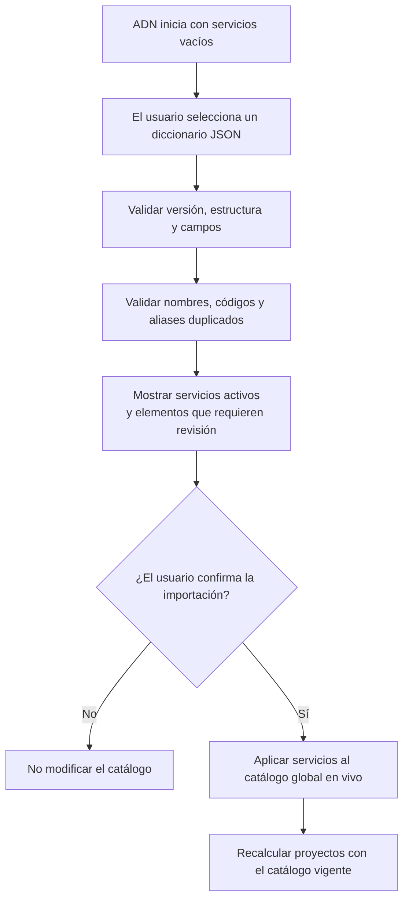
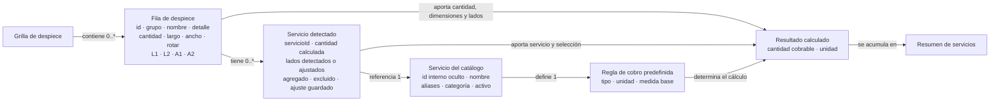
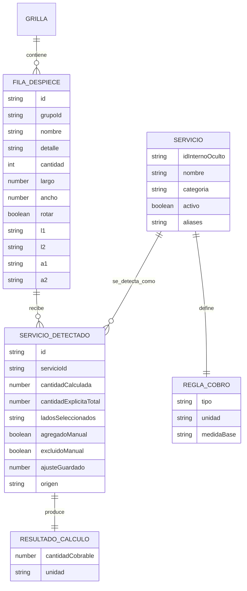
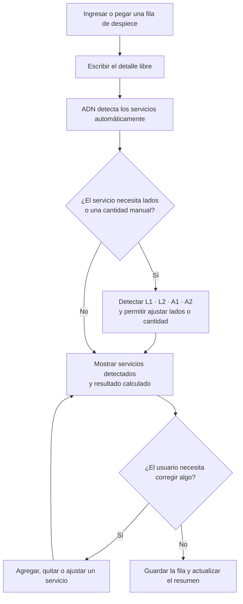
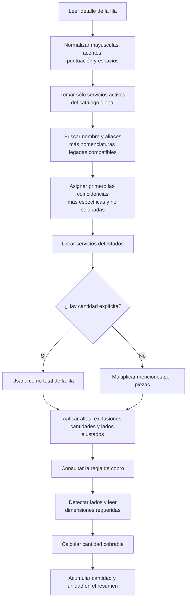
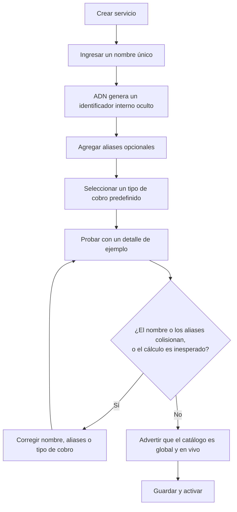

# Modelo propuesto para piezas y servicios en ADN

Este modelo simplifica el trabajo del usuario sin perder la detección automática que ya funciona en ADN. La pieza conserva un detalle libre; el sistema detecta los servicios y crea aplicaciones estructuradas que pueden verificarse, calcularse y resumirse.

## Decisión principal

> Una fila de despiece representa una o más piezas iguales. La fila puede tener cero o varios servicios detectados. ADN vuelve a detectarlos desde el detalle y sólo guarda los ajustes manuales realizados por el usuario.

Cada servicio pertenece al catálogo global del usuario, tiene un identificador interno generado y oculto, términos de detección y uno de los tipos de cobro ya disponibles. El usuario trabaja con el nombre del servicio, no con la nomenclatura.

## Reglas confirmadas

- Los nombres de servicios activos son únicos dentro del catálogo del usuario.
- El nombre siempre participa en la detección; los aliases agregan formas alternativas.
- Un servicio sólo puede desactivarse: no se elimina del catálogo ni pierde su identidad.
- Un servicio inactivo permanece guardado, pero no se detecta ni se cuenta.
- El catálogo es global y en vivo para el usuario.
- Editar nombre, aliases, activación o tipo de cobro recalcula también los proyectos anteriores.
- ADN debe advertir esta consecuencia antes de guardar un cambio global, aunque no requiere confirmación por proyecto.
- El modelo calcula cantidades y unidades, no dinero.
- Si el detalle incluye una cantidad explícita, esa cantidad es el total de la fila y no se multiplica por la cantidad de piezas.
- Si no hay cantidad explícita, cada mención se aplica una vez por cada pieza de la fila.
- Los lados se detectan desde L1, L2, A1 y A2, pero el usuario puede corregirlos.
- Una fila puede guardar ajustes para agregar, excluir o cambiar cantidad y lados de un servicio detectado.
- `rotar` continúa siendo una marca sin efecto sobre dimensiones o lados.
- ADN inicia con el catálogo de servicios especiales vacío.
- Ningún diccionario se carga automáticamente.

## Diccionarios de servicios

Los diccionarios son archivos JSON de texto plano con el mismo esquema. El sistema los validará, mostrará una vista previa y sólo los aplicará después de una importación explícita.

| Diccionario | Ubicación | Propósito | Distribución |
|---|---|---|---|
| Códigos Madecentro | Archivo privado de migración | Migrar proyectos y términos legados | Privado; fuera del producto y del repositorio |
| Códigos generales | `config/service-dictionaries/codigos-generales.json` | Plantilla neutral opcional sin perfilería de aluminio | Puede distribuirse, pero tiene `autoload: false` |

El diccionario privado conserva códigos y aliases antiguos únicamente para migración. El diccionario general contiene nombres descriptivos; los servicios cuya geometría necesita confirmación permanecen inactivos y marcados con `requiresReview: true`.

### Esquema común

```json
{
  "schemaVersion": "1.0",
  "dictionary": {
    "id": "identificador-del-diccionario",
    "name": "Nombre visible",
    "kind": "tipo-de-diccionario",
    "language": "es",
    "autoload": false,
    "visibility": "private-or-product",
    "description": "Finalidad del diccionario"
  },
  "services": [
    {
      "code": "CODIGO_ESTABLE",
      "name": "Nombre descriptivo",
      "description": "Significado breve",
      "aliases": [],
      "chargeType": "unidad",
      "measurementBasis": "unit",
      "active": true,
      "requiresReview": false
    }
  ]
}
```

### Proceso de importación



## Modelo conceptual



## Responsabilidad de cada concepto

| Concepto | Responsabilidad | No debería hacer |
|---|---|---|
| Grilla de despiece | Contener las filas del despiece | Definir reglas de servicios |
| Fila de despiece | Representar una o más piezas iguales | Contener la configuración completa del servicio |
| Detalle | Conservar el texto ingresado por el usuario | Ser el dueño del ID, nombre o dimensiones de la pieza |
| Servicio | Definir una operación disponible | Representar una aplicación concreta sobre una pieza |
| Identificador interno | Identificar el servicio de manera estable sin exigir un código al usuario | Utilizarse como nombre visible o comportamiento comercial |
| Servicio detectado | Representar la detección actual y conservar sólo sus ajustes manuales | Redefinir el catálogo global |
| Regla de cobro | Determinar qué datos leer y cómo calcular | Detectar texto del detalle |
| Resultado calculado | Mostrar la cantidad cobrable y su unidad | Modificar la fila o el catálogo |

## Cardinalidades



## Proceso simple para el usuario

El usuario mantiene un único flujo principal. ADN sólo pide información adicional cuando el servicio realmente la necesita.



### Principios de experiencia

- La detección automática sigue siendo el camino normal.
- Los servicios se vuelven a detectar desde el detalle; sólo se guardan las correcciones manuales.
- El usuario no completa formularios adicionales para servicios simples.
- Los lados sólo se muestran cuando cambian el cálculo y siempre pueden corregirse.
- El sistema siempre muestra qué detectó y cuánto contará.
- El usuario puede agregar, excluir o ajustar cantidad y lados en una fila.
- Una corrección manual afecta esa fila, no redefine el catálogo.
- El detalle original se conserva sin reescrituras automáticas.
- `rotar` permanece como una marca y no modifica dimensiones ni lados.

## Proceso del sistema



## Reglas de cobro

La regla de cobro pertenece al servicio, se selecciona de una lista predefinida y declara qué información necesita. Este modelo calcula cantidades, no valores monetarios.

| Tipo | Datos necesarios | Cantidad cobrable |
|---|---|---|
| Unidad con cantidad explícita | Número escrito junto al servicio | `cantidad explícita total de la fila` |
| Unidad sin cantidad explícita | Menciones detectadas | `piezas × menciones por pieza` |
| Lado | Lados detectados o ajustados | `piezas × lados seleccionados` |
| Metro lineal | Dimensión o suma de lados | `piezas × longitud en metros` |
| Metro cuadrado | Largo y ancho | `piezas × largo × ancho` |
| Escala | Dimensión y tramo | `piezas × tramos calculados` |
| Manual | Cantidad ajustada por el usuario | `cantidad total indicada para la fila` |

### Ejemplo

Una fila representa dos piezas de `600 × 600` con Curva y Enchape curvo en `L1`:

```text
Cantidad de piezas: 2
Servicios aplicados:
- Curva: 1 aplicación por pieza
- Enchape curvo: lado L1, longitud 0,6 m por pieza

Resultado:
- Curva: 2 unidades
- Enchape curvo: 1,2 m
```

## Creación de un servicio nuevo



El servicio no debería activarse sin una prueba que muestre:

- Texto reconocido.
- Servicio detectado.
- Cantidad resultante.
- Unidad de cobro.
- Posibles colisiones con otros servicios.

El usuario no ingresa ni administra nomenclaturas. ADN conserva un identificador interno estable y mantiene las nomenclaturas existentes sólo por compatibilidad con proyectos anteriores. El nombre visible debe ser único y se utiliza automáticamente como término de detección. Los servicios no se eliminan: se desactivan para conservar referencias y ajustes anteriores.

## Adaptación desde el código actual

| Implementación actual | Concepto propuesto | Adaptación |
|---|---|---|
| `despieces[].filas` | Filas de despiece | Se conserva |
| `cant`, `largo`, `ancho`, `detalle` | Datos de la fila | Se conservan |
| `l1`, `l2`, `a1`, `a2` | Lados disponibles | Se conservan |
| `rotar` como marcador `X` | Marca visual | Se conserva sin modificar dimensiones ni lados |
| `servicios` / `serviciosGuardados` | Catálogo de servicios | Se migra hacia un catálogo global en vivo por usuario |
| `nomenclatura` | Identificador legado | Se conserva internamente para proyectos existentes y se oculta al usuario |
| `nombreOriginal` | Nombre visible del servicio | Pasa a ser el dato principal ingresado por el usuario |
| `aliases` | Términos de detección | Se conservan |
| `tipoCobro` | Tipo de cobro predefinido | Se conserva y se presenta como una selección simple |
| `serviceCounts` | Resumen derivado | Se conserva como salida calculada de cantidades y unidades |
| `narizCobro`, `enchapeCobro`, `engnaCobro` | Ajuste manual del servicio aplicado | Se generalizan gradualmente |
| Cantidades como `2 curva` | Hoy se combinan con `cant` | Pasan a representar un total explícito de la fila |
| Reglas especiales por nomenclatura | Tipo de cobro predefinido | Se migran una por una, sin cambio masivo |

## Estrategia de adopción

1. Corregir primero el mapa y el vocabulario sin cambiar el comportamiento.
2. Retirar los servicios especiales incluidos por defecto y comenzar con un catálogo vacío.
3. Implementar el lector y validador del esquema JSON v1 sin cargar archivos automáticamente.
4. Mantener Códigos Madecentro como archivo privado de migración fuera del producto.
5. Ofrecer Códigos generales únicamente como plantilla importable opcional.
6. Consolidar los servicios importados en un catálogo global y mantener compatibilidad con nomenclaturas legadas.
7. Recalcular todos los proyectos con el catálogo vigente y advertir el efecto retroactivo al editarlo.
8. Introducir una representación derivada de servicios detectados a partir del `detalle`.
9. Guardar únicamente altas, exclusiones y ajustes manuales de cantidad o lados.
10. Cambiar con pruebas la semántica de cantidades explícitas: `2 curva` significa dos en total para la fila.
11. Mantener `serviceCounts` como resultado compatible.
12. Generalizar los campos manuales existentes en un ajuste por servicio detectado.
13. Mover las reglas especiales hard-coded a tipos de cobro predefinidos de forma incremental.

## Criterios para evaluar el modelo

- [ ] ADN inicia sin servicios especiales configurados.
- [ ] Los diccionarios tienen `autoload: false` y sólo se aplican con confirmación.
- [ ] Códigos Madecentro permanece fuera del producto como archivo privado de migración.
- [ ] Códigos generales no contiene servicios de perfilería de aluminio.
- [ ] Una fila puede tener cero, uno o varios servicios.
- [ ] El identificador interno se genera automáticamente y permanece oculto al usuario.
- [ ] El usuario crea el servicio ingresando un nombre único y seleccionando un tipo de cobro existente.
- [ ] El nombre siempre participa en la detección y los aliases agregan alternativas.
- [ ] Los servicios no se eliminan; un servicio inactivo no se detecta ni se cuenta.
- [ ] El catálogo global vigente recalcula todos los proyectos del usuario.
- [ ] El tipo de cobro pertenece al servicio.
- [ ] Los lados pertenecen a la detección concreta del servicio.
- [ ] Una cantidad explícita representa el total de la fila y no se multiplica por piezas.
- [ ] Sin cantidad explícita, cada mención se multiplica por la cantidad de piezas.
- [ ] Los lados se detectan automáticamente y pueden corregirse.
- [ ] El usuario puede agregar, excluir o ajustar un servicio sin editar el catálogo.
- [ ] Sólo se guardan esos ajustes manuales; la detección normal se recalcula desde el detalle.
- [ ] Un servicio nuevo puede probarse antes de activarse.
- [ ] El sistema puede conservar proyectos existentes durante la transición.
- [ ] El detalle original permanece intacto.
